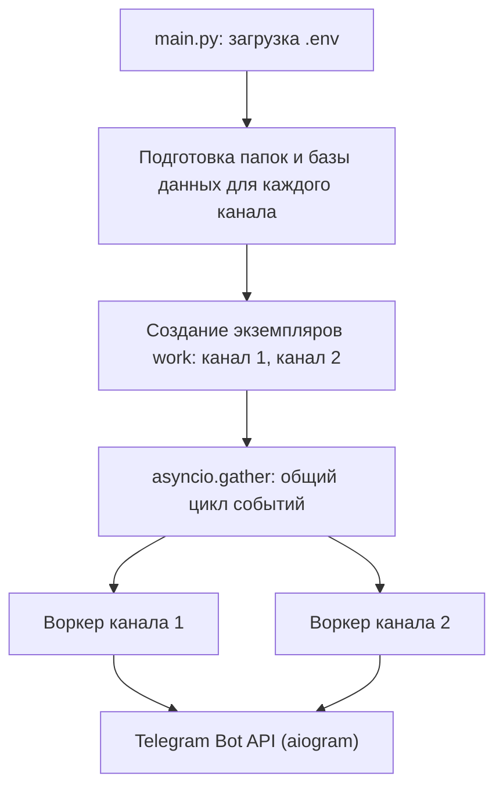
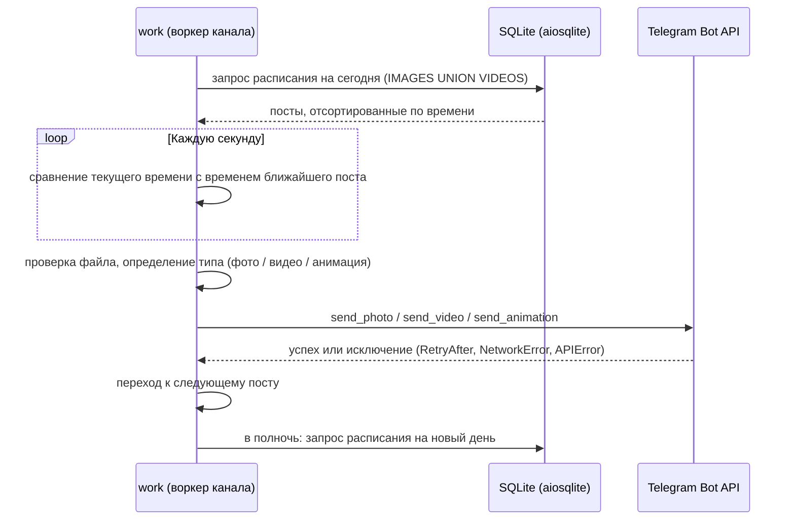

# 📡 postingMediaInChannel

> Асинхронный сервис автопостинга фото и видео сразу в **несколько Telegram-каналов**. Сам готовит файлы, строит расписание публикаций, распределяет контент равномерно и публикует его в нужное время — без участия человека.


---

## 📌 О проекте

Ручное ведение медиаканала отнимает время: нужно разбирать папки с файлами, не публиковать дубли, чередовать картинки и видео, соблюдать паузы между постами и ещё не забыть выложить всё вовремя. Если каналов несколько, нагрузка растёт кратно.

**postingMediaInChannel** автоматизирует весь этот процесс:

1. Приводит в порядок папки с контентом (удаляет дубликаты и миниатюры, исправляет расширения).
2. Строит расписание публикаций в локальной базе данных.
3. Равномерно перемешивает фото и видео в заданной пропорции.
4. Публикует контент в каналы в запланированное время, **одновременно для всех каналов**.

Один экземпляр класса `work` обслуживает один канал, поэтому подключить ещё один канал — значит добавить четыре переменные в `.env` и создать ещё один экземпляр.

---

## ✨ Ключевые возможности

- **Мультиканальность.** Каждый канал — отдельный воркер со своим ботом, папкой контента и базой данных. Воркеры работают параллельно в одном event loop (`asyncio.gather`) и не блокируют друг друга.
- **Умное расписание.** Интервал между постами случайный (10–20 минут плюс случайные секунды), поэтому публикации выглядят естественно, а не по таймеру.
- **Пропорциональное распределение контента.** Фото и видео равномерно чередуются, а не идут блоками. Например, 6 фото и 2 видео превращаются в последовательность `фото, фото, фото, видео, фото, фото, фото, видео`.
- **Автоматическая подготовка контента.** Удаление дублей (`(1)`) и миниатюр (`thumb`), приведение расширений к `.jpg` и `.mp4`.
- **Выбор способа отправки по длительности видео.** Ролики длиннее 10 секунд уходят как видео, короткие — как анимация (`send_animation`). Длительность определяется через MoviePy.
- **Обработка ошибок Telegram API.** Перехватываются ограничение частоты запросов (`TelegramRetryAfter`), сетевые сбои (`TelegramNetworkError`) и прочие ошибки API (`TelegramAPIError`), поэтому сбой одного поста не останавливает работу сервиса.
- **Безопасная конфигурация.** Токены ботов, ID каналов и пути лежат в `.env` и не попадают в репозиторий.

---

## 🎯 Что демонстрирует проект

| Навык | Как это показано в проекте |
|-------|----------------------------|
| **Асинхронное программирование** | `async/await`, `asyncio.gather`, `asyncio.sleep`, неблокирующий доступ к БД через `aiosqlite`; несколько долгоживущих задач в одном цикле событий |
| **Работа с Telegram Bot API** | Фреймворк `aiogram 3`: `Bot`, `FSInputFile`, `send_photo` / `send_video` / `send_animation`, типизированные исключения |
| **Проектирование БД** | SQLite: схема из трёх таблиц, `UNION`-запросы, пакетная вставка `executemany`, отдельная база на каждый канал |
| **Алгоритмы** | Пропорциональное слияние двух последовательностей методом накопления ошибки (идея алгоритма Брезенхэма) за один проход |
| **ООП** | Разделение ответственности: класс `database` готовит данные, класс `work` публикует; конфигурация передаётся через конструктор |
| **Работа с медиа** | MoviePy: чтение длительности видео и выбор способа отправки |
| **Работа с файловой системой** | `os`, `pathlib`: проверка, очистка и нормализация папок с контентом |
| **Конфигурация и безопасность** | `python-dotenv`, секреты вне кода, `.env.example` |
| **Современный Python** | `match/case`, f-строки, `pathlib` |
| **Надёжность** | Обработка исключений внешнего API, журналирование ключевых этапов в файл |

---

## 🛠 Технологии

| Область | Инструменты |
|---------|-------------|
| Язык | Python 3.10+ |
| Telegram | aiogram 3 |
| Асинхронность | asyncio |
| База данных | SQLite, `sqlite3`, `aiosqlite` |
| Видео | MoviePy |
| Конфигурация | python-dotenv |
| Утилиты | tqdm (прогресс-бар подготовки), pathlib, logging |
| Контроль версий | Git / GitHub |

---

## 🏗 Архитектура



### Жизненный цикл воркера



### Структура репозитория

```
postingMediaInChannel/
├── main.py                  # Точка входа: подготовка данных, запуск воркеров
├── classes/
│   ├── class_database.py    # Подготовка контента и построение расписания
│   └── work.py              # Воркер канала: расписание, проверки, публикация
├── sql/
│   └── selectalldatestoday.sql   # Пример запроса расписания на день
├── requirements.txt
├── .env.example
└── README.md
```

### Схема базы данных

Для каждого канала создаётся собственный файл `DataBase.db`.

| Таблица | Поля | Назначение |
|---------|------|-----------|
| `IMAGES` | `id`, `name_pic`, `time_to_post` | Расписание публикации фотографий |
| `VIDEOS` | `id`, `name_video`, `time_to_post` | Расписание публикации видео |
| `PROMOTION` | `id`, `name_media`, `text_media`, `time_to_post` | Заготовка под рекламные публикации |

---

## ⚙️ Как это работает

1. **Подготовка.** Для каждого канала `database` проверяет наличие базы. Если её нет, создаются таблицы, затем папки с контентом очищаются от дублей и миниатюр, а расширения файлов приводятся к единому виду.
2. **Построение расписания.** Список файлов формируется так, чтобы фото и видео равномерно чередовались. Каждому файлу назначается время публикации: от предыдущего поста его отделяет случайная пауза.
3. **Запуск воркеров.** `main.py` создаёт по экземпляру `work` на канал и запускает их через `asyncio.gather`.
4. **Цикл публикации.** Воркер каждую секунду сверяет текущее время с расписанием. В нужный момент он проверяет файл, выбирает способ отправки и публикует пост с подписью канала.
5. **Новый день.** После окончания контента на сегодня воркер ждёт начала следующих суток и загружает новое расписание.

### Алгоритм равномерного распределения

Чтобы чередовать два списка в пропорции их длин, используется накопление «долга» по каждому списку. На каждом шаге выбирается тот список, чей элемент сейчас нужнее для баланса:

```
(count1 + 1) * len2  <=  (count2 + 1) * len1   →  берём элемент из первого списка
иначе                                           →  берём элемент из второго списка
```

Сложность — O(n), дополнительная память — O(n) под результат.

---

## 🚀 Установка и запуск

### Требования
- Python 3.10 или новее
- Telegram-бот (токен выдаёт [@BotFather](https://t.me/BotFather)), добавленный **администратором** в канал с правом публикации сообщений

### Шаги

```bash
git clone https://github.com/Fllleshka/postingMediaInChannel.git
cd postingMediaInChannel

python -m venv .venv
.venv\Scripts\activate            # Windows
# source .venv/bin/activate       # Linux / macOS

pip install -r requirements.txt

copy .env.example .env            # затем заполните значения
```

### Подготовка папок

Для каждого канала нужна своя главная папка со следующей структурой:

```
<MAINFOLDER>/
├── photos/          # фотографии
└── video_files/     # видео (.mp4)
```

База `DataBase.db` создаётся в этой же папке автоматически. Журнал работы пишется в `../dates/telegramchennels.log`, поэтому папка `dates` должна существовать рядом с проектом.

### Переменные окружения (`.env`)

| Переменная | Описание |
|-----------|----------|
| `FIRSTMAINFOLDER` | Путь к главной папке первого канала |
| `FIRSTBOTKEY` | Токен бота первого канала |
| `FIRSTNAMECHANNEL` | Подпись под публикациями первого канала |
| `FIRSTIDCHANNEL` | ID канала (`-100…`) или `@username` |
| `SECONDMAINFOLDER` | Путь к главной папке второго канала |
| `SECONDBOTKEY` | Токен бота второго канала |
| `SECONDNAMECHANNEL` | Подпись под публикациями второго канала |
| `SECONDIDCHANNEL` | ID второго канала |

### Запуск

```bash
python main.py
```

---

## 🗺 Планы развития

- [ ] Хранить статус публикации (`posted`) в базе, чтобы после перезапуска не терять прогресс и не дублировать посты
- [ ] Повторная отправка при `TelegramRetryAfter` и сетевых ошибках с учётом паузы, которую просит Telegram
- [ ] Заменить опрос «каждую секунду» на ожидание до времени ближайшего поста
- [ ] Вынести определение длительности видео в `asyncio.to_thread`, чтобы не блокировать цикл событий
- [ ] Параметризованные SQL-запросы вместо сборки строк
- [ ] Полноценное логирование (`logging` с ротацией) вместо `print`
- [ ] Автотесты (`pytest`, `pytest-asyncio`) с подменой Telegram API
- [ ] Масштабирование на произвольное число каналов через конфигурационный файл
- [ ] Использование таблицы `PROMOTION` для рекламных публикаций
- [ ] Контейнеризация (Docker) и запуск как системной службы

---

## 👤 Автор

**Fllleshka** — [github.com/Fllleshka](https://github.com/Fllleshka)

<!-- TODO: добавьте контакты для связи: Telegram, e-mail, LinkedIn -->
